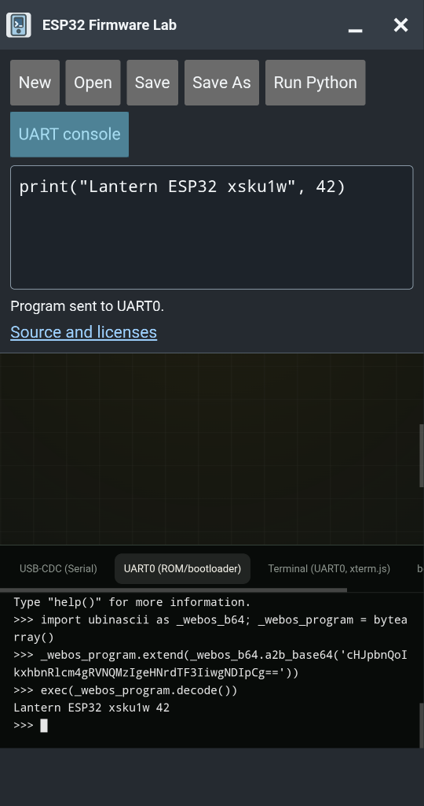
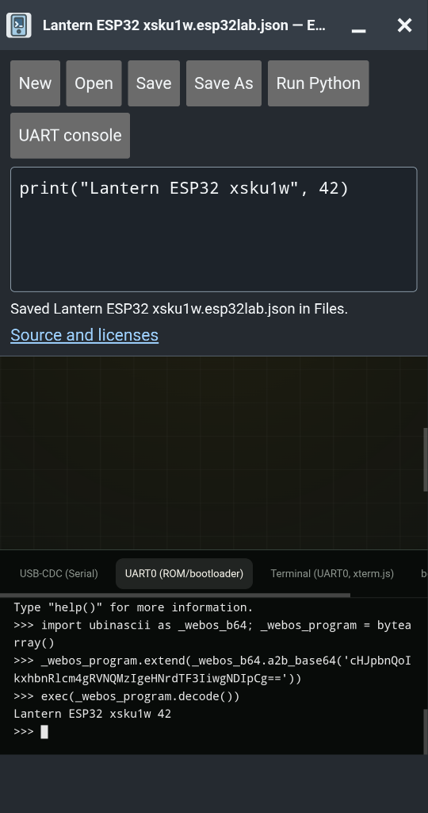

# ESP32 Firmware Lab on the Galaxy S10+

Open **Electronics → ESP32 Firmware Lab**. Tap **Run Python** while the
LilyGO T-Display starts. The app waits for the MicroPython prompt to
accept the program. Tap **UART console** and look for `GPIO 2: 1`.

Replace the starter program with `print("Lantern ESP32", 42)` and run it.
The actual emulated ESP32 prints `Lantern ESP32 42` in the UART console.
The editor and its status follow the WebOS color scheme. Run Python
remains reachable above the Android keyboard.

## Save and reopen a program

1. Choose **Save** and select a folder in **My files**. Enter a bare
   name to create an editable `.esp32lab.json` project.
2. Choose **Save As** and enter a name ending in `.py` for a UTF-8
   Python export. A wrong suffix shows an error without losing the program.
3. Close the app and use **Open** in **My files** to reopen the project
   in ESP32 Firmware Lab. Edit and save again to update the same file.
4. Use **Open** inside ESP32 Firmware Lab to open the Python copy and
   run it. From **My files**, a Python file opens in Text Editor when
   no existing window is bound to that file.

Signed-in Files projects reopen in a fresh browser session. Guest files
use temporary My files during the current session.

## Verification and build

The physical Galaxy S10+ ran Chrome 158.0.8127.92 at about 411 CSS pixels
wide. The wider checks used Chromium 158.0.8127.36 at 820 and 1300 CSS
pixels. Signed-in checks compared the stored project JSON and UTF-8 source,
resaved changed code at the same path, and reran both programs in a fresh
session. A cancelled Open preserved the program. Minimizing restored the
phone launcher. The virtual UART tests exercised prompt retry and disposal,
and 12 shared Files association tests passed.

The phone and desktop verified four workflow groups. They ran the stock GPIO
program, edited and ran custom Python, reopened and revised a saved project,
and reopened a Python export. Other firmware and board configurations,
peripheral and network controls, native terminal and debugging controls,
and flash and storage workflows still need individual checks.

The WebOS runtime source is `d72c20b54526d56ca203b8e9f38d0a4025bf322e`.
The build reused the verified WebAssembly engine, ROM and MicroPython
inputs from the previous package. See the preparation and bundling
instructions in the [WebOS build guide](../../webos/README.md).

Viewer `0bdf8d505ab31aaed5349cf08f8d5162ff206044de4f316657dd36be4f198fc5`
passed all 81 changed HTTPS path checks. On ksu.codes, the S10+ ran the
stock GPIO example and repeated the edit, temporary save, reopen and
rerun cycle as a guest. The two screenshots above are from that replay.

[WebOS release and rollback](https://github.com/CC-David-CC/WebOS/blob/webos/esp32-phone-programs/deploy/ACTIVE-RELEASE.md#esp32-firmware-lab-phone-startup-and-files)
